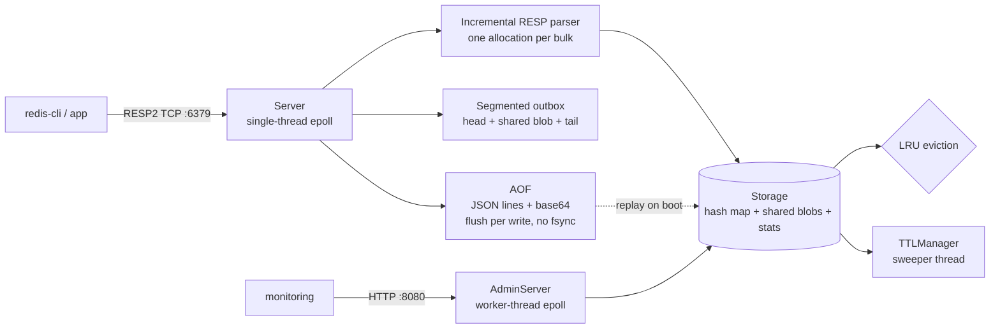

# PolyCache

**A Redis-protocol cache in C++17 for ordinary values and large binary blobs — text, numbers, JSON, images, PDFs, and database rows up to 512MB each.**

[](https://github.com/ima-d-ice/polycache/actions)  [](LICENSE)


## What it is

PolyCache is a single-node, in-memory key/value cache that speaks RESP2, the
Redis wire protocol. Values are opaque binary strings: the server does not
inspect, encode, or re-encode them. That means a JSON row, a 100KB PNG, and a
512MB object all take the same path through the parser, storage, and GET
response.

The blob path is not a size check bolted onto a small-value cache. The RESP
parser is incremental and sizes each bulk once; GET returns a reference to the
stored value instead of copying it; the outbox streams a header, the shared
value, and a trailer. The server was tested end-to-end with a 512MB value
(hash matched) and the benchmark below uses real 1KB and 1MB payloads.

## Highlights

- **Binary-safe values from 0 to 512MB.** No 64KB frame buffer. The RESP
  parser streams each bulk once; a 512MB object round-trips byte-for-byte.
- **Zero-copy GETs.** Values stream straight out of storage without copying
  the payload.
- **Measured blob throughput.** 1KB rows: **~310K SET/s, ~245K GET/s**. 1MB
  images: **~4.6K GET/s**. 512MB resident set: **524.5MB RSS**.
- **Observability.** `GET /metrics` exposes memory, hits/misses, evictions,
  expirations, largest value. `GET /health` is a liveness check.
- **Binary-safe AOF, with a caveat.** Keys and values are base64-encoded into
  JSON lines. The log is flushed per write but **not fsynced**; see
  [Persistence status](#persistence-status-read-this-before-trusting-the-aof).

## Quick start

```bash
make                 # builds ./polycache
make test            # test_protocol + test_storage

# Defaults: port 6379, admin 8080, 1024MB memory, 512MB max value, AOF on.
./polycache
./polycache --no-aof
./polycache --memory-limit 2048 --max-value-size 512
```

`--max-value-size` and `--memory-limit` are in MB. Keep the maximum value below
the memory limit. A value above `--max-value-size` gets
`-ERR value too large (max-value-size)`; a value that would not fit the current
memory limit gets `-ERR value too large for memory limit`. Neither is silently
evicted after the fact.

Talk to it with any Redis client:

```bash
redis-cli -p 6379 SET greeting "hello polycache"
redis-cli -p 6379 SET row:42 '{"id":42,"name":"alice","active":true}'

# Binary blob in, binary blob out. Use -x to avoid shell quoting.
redis-cli -p 6379 -x SET image:demo < photo.jpg

# redis-cli --raw appends a newline to stdout; trim it with the file size.
redis-cli -p 6379 --raw GET image:demo | head -c "$(wc -c < photo.jpg)" > out.jpg
cmp -s photo.jpg out.jpg && echo identical

curl -s http://127.0.0.1:8080/metrics
curl -s http://127.0.0.1:8080/health
```

Graceful shutdown on `SIGINT`/`SIGTERM`. Requires `g++` with C++17 and `make`
(`redis-cli`/`curl` only for the examples). The Dockerfile compiles the server
from source; CI also runs `make test`.

```bash
docker build -t polycache .
docker run --rm -p 6379:6379 -p 8080:8080 polycache
```

## Architecture

One single-threaded `epoll` loop owns all client I/O; a second `epoll` loop on a
worker thread serves admin HTTP. All cache state is behind one mutex-guarded
`Storage`. The only other thread is the TTL sweeper.



### How a large value flows

1. The parser reads a `$<len>` header and allocates the argument string once at
   that length. Payload bytes go directly from the `recv()` chunk into the
   string; there is no intermediate frame buffer and no second full copy.
2. `Storage::set` moves the string into a `shared_ptr<const std::string>` and
   charges the eviction policy for capacity plus per-entry metadata. A value
   that does not fit the configured limits is rejected before the AOF is
   touched.
3. `GET` copies the `shared_ptr`, not the bytes. The outbox queues a small
   header, the shared blob, and a `\r\n` trailer. Partial sends resume when the
   fd becomes writable; an eviction or overwrite cannot free bytes that a
   response is still streaming.
4. The AOF base64-encodes keys and values before writing JSON. That is what
   makes a JPEG safe to persist; it is also why large values and the AOF are a
   poor match (see below).

## Benchmarks

### Blob path (current build)

Apple M1, 8GB RAM, macOS 26.5, loopback TCP, one client, `--no-aof`, three
fresh-server runs, medians. 1KB values are JSON-like 1,024-byte rows; 1MB
values are random binary bytes. The 1MB run uses 512 keys, about half of the
1GB budget; the 1KB run uses 20,000 keys (20MB). The working set fits, so this
is a throughput measurement, not an eviction test. SET/GET MB/s are decimal
(1e6 bytes/s); used/RSS are MiB.

| Payload | Keys | SET ops/s | SET MB/s | GET ops/s | GET MB/s | SET p50/p99 | GET p50/p99 | used | RSS | hit rate |
| :--- | ---: | ---: | ---: | ---: | ---: | ---: | ---: | ---: | ---: | ---: |
| 1KB row | 20,000 | 310,081 | 317.5 | 245,093 | 251.0 | 0.03 / 0.05 ms | 0.03 / 0.06 ms | 22.5MB | 33.2MB | 1.000 |
| 1MB image | 512 | 3,895 | 4,084.0 | 4,566 | 4,787.6 | 0.24 / 0.29 ms | 0.29 / 0.46 ms | 512.1MB | 524.5MB | 1.000 |

Reproduce with:

```bash
python3 blob_bench.py --runs 3
```

The script starts its own servers on free ports, pipelines SET/GET, and reports
client-observed throughput plus `used_memory` from `/metrics` and RSS from
`ps`. Server RSS is 524.5MB for 512.1MB charged to the cache: the difference is
process baseline, hash buckets, allocator slack, and the parser's in-flight
payload. The 1MB GET figure is memory-to-loopback, not disk or network.

**512MB smoke test:** a 512MB binary SET took 0.36s and GET took 0.27s with a
1GB memory limit and `--no-aof`; SHA-256 of the sent and received streams
matched. This is a manual correctness check, not part of the three-run table.

## Persistence status (read this before trusting the AOF)

- The AOF is one JSON line per `SET`/`DEL`, with **base64-encoded keys and
  values**. This fixes the old crash: a JPEG/PDF contains invalid UTF-8, and
  `nlohmann::json::dump()` used to throw `type_error.316` on the value, which
  propagated out of `main` and killed the server. Base64 output is ASCII, so
  binary payloads now replay correctly (verified with a 100KB binary key/value
  pair and a restart).
- **There is no `fsync`/`fdatasync` in this build.** `AOFLogger::append_line`
  writes to an `ofstream` and calls `flush()`; a power loss or OS crash can lose
  recent writes. Treat the AOF as a best-effort replay log, not a durable
  database.
- There is no runtime AOF rewrite or compaction. The log grows with every
  write; startup compaction is not implemented.
- Base64 inflates a value by ~33%. A 512MB value under the default AOF needs a
  multi-hundred-MB temporary allocation for the encoded string and JSON
  serialization; use `--no-aof` for large blobs. The blob benchmark and demo
  run with `--no-aof`.

`--no-aof` disables the writer and replay entirely.

## Features

- **Protocol** — RESP2 only: `*<count>\r\n` arrays of `$<len>\r\n<data>\r\n`
  bulk strings, binary-safe and pipelined. Verbs: `SET`, `GET`, `DEL`,
  `METRICS`, `SWITCH_POLICY`, `PING`, `SELECT`. Unknown verbs get an explicit
  error.
- **Streaming parser** — per-client state machine; fragments across any
  `recv()` boundary; one allocation per bulk; argument count ≤ 1024; declared
  bulk length capped at the smaller of `--max-value-size` and `--memory-limit`
  plus a 1MB overshoot, so a just-over-limit value returns a clean error. A
  declaration far above the cap is a protocol error and the connection is
  closed.
- **Storage** — values are shared binary blobs; default 1024MB memory limit and
  512MB max value; keys up to 1MB. The eviction policy is charged for
  `value.capacity() + 128B` plus the key, and the bucket array is included in
  `used_memory`, so the limit is closer to real RSS than `key.size +
  value.size`.
- **Eviction** — LRU behind one interface. All policy calls happen under the
  storage lock.
- **TTL** — `SET … EX seconds` and `PX milliseconds`; background sweeper
  (~100ms) plus lazy expiry on read. TTLs are stored at second granularity;
  `PX` rounds up so a sub-second TTL never becomes "no expiry".
- **Metrics** — `/metrics` fields: `total_keys`, `used_memory`,
  `used_memory_peak`, `memory_limit`, `max_value_size`, `hits`,
  `misses`, `hit_rate`, `miss_rate`, `evictions`, `expired_keys`,
  `avg_item_bytes`, `largest_item_bytes` (largest value seen since boot; plus
  `memory_bytes` as a compatibility alias). `/health` returns
  `{"status":"ok"}`.
- **Tests** — `make test` runs `tests/test_protocol.cpp` (fragmentation,
  pipelining, binary payloads, oversized bulk, bad headers, empty
  keys/values) and `tests/test_storage.cpp` (binary round-trip, limits,
  eviction, empty-key eviction, TTL, overwrite accounting).

## Design decisions

1. **Streaming parser over a frame buffer.** A 512MB value should be copied
   once from `recv()` into its final string, not into a 512MB frame buffer and
   then into a value. The state machine keeps only the in-progress header and
   current argument.
2. **Shared values over copies.** `GET` is the common large-value operation;
   returning `shared_ptr<const string>` makes it zero-copy and makes eviction
   safe while a response is in flight.
3. **Single-threaded `epoll` over a pool.** Cache ops are short map lookups;
   thread handoff would cost more than it saves. The tradeoff is explicit: one
   slow 512MB operation blocks the loop, which is documented below.
4. **RESP2 instead of a custom protocol.** `redis-cli` and `redis-benchmark`
   work without a bespoke client. (`redis-benchmark` warns that `CONFIG` is not
   supported, but SET/GET run.)
5. **Explicit errors over silent option loss.** `SET` supports `EX`, `PX`, and
   the legacy positional TTL. `NX`, `XX`, `GET`, and `KEEPTTL` return
   `-ERR unsupported SET option: …` instead of being ignored and changing the
   caller's semantics.

## Project structure

```
src/
  server.{h,cpp}      single-thread epoll loop, segmented outbox, RESP dispatch
  storage.{h,cpp}     mutex-guarded map, shared blobs, limits, stats, policy switch
  protocol.{h,cpp}    incremental RESP2 parser (no frame buffer)
  eviction/           policy.h + lru.cpp / lfu.cpp / sieve.cpp
  aof.{h,cpp}         JSON-line AOF with base64 keys/values, flush-only, replay
  ttl.{h,cpp}         background expiry sweeper
  admin.{h,cpp}       HTTP /metrics + /health on a worker-thread epoll loop
  main.cpp            CLI flags, signal handling, boot order
  epoll_compat.h      epoll→poll shim for macOS builds only
tests/                plain C++17 assert tests; wired to `make test`
blob_bench.py         real 1KB/1MB payload benchmark + RSS/used_memory
tools/make_demo_gif.py  generates demo.gif from a real session (Pillow)
demo.gif
Dockerfile / Makefile / .github/workflows/ci.yml
```

## Limitations & future work

- **AOF durability:** flush, not fsync; no rewrite/compaction; base64 overhead;
  large blobs should use `--no-aof`. This is the biggest open gap.
- **Single-threaded:** a 512MB SET/GET or a slow client can stall other clients.
  Per-connection outboxes do not add worker threads.
- **No auth, TLS, or `maxclients`:** the listener binds all interfaces. Run it
  on a trusted network or put a proxy in front.
- **RESP2 subset:** no hashes, lists, sets, streams, transactions, pub/sub,
  replication, cluster, Lua, `SCAN`, `MGET`/`MSET`, or runtime expiry commands.
  `SELECT` is accepted and ignored (one database).
- **SET modifiers:** `NX`/`XX`/`GET`/`KEEPTTL` are rejected, not implemented.
- **TTL granularity:** seconds; `PX` rounds up to the next second. AOF replay
  re-applies the logged TTL as a fresh duration, not an absolute deadline.
- **Memory accounting is an estimate:** capacity + 128B/entry + bucket array;
  allocator behavior and in-flight GETs can push RSS above the configured
  limit. The 512MB smoke test and 1MB benchmark report actual RSS separately.
- **Oversized declarations:** values up to the effective max (the smaller of
  `--max-value-size` and `--memory-limit`) plus 1MB get a clean error; a
  declaration far above that is a protocol error and closes the connection
  (the parser does not drain/discard a multi-GB payload).
- **Single node:** no replication or clustering; cache state is in RAM.

## Tech stack & contact

C++17 · Linux `epoll` (macOS `poll` shim) · `nlohmann/json` (sole vendored
dependency) · Pillow for the demo GIF · Docker · GitHub Actions.

GitHub: https://github.com/ima-d-ice
