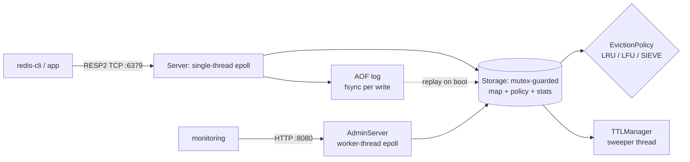

# PolyCache

**A Redis-protocol-compatible in-memory cache in C++17 with hot-swappable eviction policies, crash-safe persistence, and a statistical benchmark harness.**

[](https://github.com/ima-d-ice/polycache/actions)  [](LICENSE)

## Highlights

- **Hot-swappable eviction** — switch between LRU, LFU, and SIEVE at runtime via one TCP command, with zero data loss.
- **Measured +14pt hit-rate gap** — SIEVE/LFU score 0.30 vs LRU's 0.16 on a 90K-request adversarial workload (5 seeds, mean ± std reported).
- **Redis-compatible wire protocol (RESP2)** — works with `redis-cli` and `redis-benchmark`; benchmarked head-to-head against real Redis.
- **Crash-safe by default** — synchronous append-only log with replay on boot; durability chosen over raw write throughput.
- **Strict CI gate** — unit tests, ASan+UBSan, `clang-tidy` as errors, and a reproducible Docker build all block on every push.

## Demo

Real session, captured from the running server:

```bash
$ ./polycache
PolyCache listening on port 6379, admin on port 8080, policies: lru, lfu, sieve

$ redis-cli -p 6379 SET user:42 alice
OK
$ redis-cli -p 6379 GET user:42
alice
$ redis-cli -p 6379 SWITCH_POLICY sieve
OK
$ curl -s http://127.0.0.1:8080/metrics
{"evictions":0,"hit_rate":1.0,"hits":1,"memory_bytes":12,"miss_rate":0.0,"misses":0,"policy":"sieve","total_keys":1}
$ curl -s http://127.0.0.1:8080/health
{"status":"ok"}
```

## Architecture

One single-threaded `epoll` loop owns all client I/O; all state lives behind one mutex-guarded `Storage`. Writes also append to the AOF log. A second `epoll` loop on a worker thread serves admin HTTP. The only other thread is the TTL sweeper.



## Features

- **Eviction** — hand-rolled LRU, LFU, and SIEVE behind one `EvictionPolicy` interface; `SWITCH_POLICY` rebuilds the new policy from per-key metadata (recency/frequency/visited bit) so the hot set survives the switch.
- **Protocol** — RESP2 only: binary-safe length-prefixed frames, pipelining, per-client 64KB buffer cap and arg-count guards against DoS.
- **Persistence** — one JSON line per `SET`/`DEL`, flushed synchronously; full replay on startup; `--no-aof` flag for benchmarks.
- **Expiry** — per-key TTL (`SET … EX/PX`), background sweeper (~100ms), lazy expiry check on read.
- **Observability** — `GET /metrics` (hits, misses, hit rate, evictions, memory, policy) and `GET /health` on the admin port.

## Benchmarks

Phased workload (Zipf reads → scan + churn → mixed) with a 1MB cache and a working set far larger than memory, so eviction fires on every cold write. Each mode runs in a fresh server; policy pinned once before the run.

| Mode | Overall hit rate (mean ± std, 5 seeds) | P1 Zipf | P2 Scan | P3 Mixed |
| :--- | :--- | :--- | :--- | :--- |
| **static_sieve** | **0.3041 ± 0.0502** | 0.2890 | 0.2293 | **0.3868** |
| **static_lfu** | **0.3041 ± 0.0502** | 0.2890 | 0.2293 | **0.3868** |
| static_lru | 0.1630 ± 0.0508 | 0.2885 | 0.0846 | 0.1200 |

Methodology: 90K requests, seeds `1 7 42 123 999`, `--cache-size-mb 1 --hot-size 11000`. Hardware: [TODO: CPU/RAM/OS, e.g. "M1 MacBook Air, 8GB, macOS 14"]. Throughput/latency: [TODO: req/s + p99 — measured locally against Redis via `redis-benchmark`, harness kept local-only].

## Design decisions

1. **Single-threaded `epoll` over a thread pool.** Cache ops are microsecond-scale map lookups, so thread handoff would cost more than it saves. One loop = no lock contention on the hot path; the storage mutex only guards short critical sections. (Verified correct under `poll` via a macOS compat shim; production path is real `epoll`.)
2. **SIEVE as the headline policy, not just LRU.** One hand pointer clearing visited bits gives O(1) amortized ops with scan resistance LRU lacks — and the +0.14 P3 gap above is the receipt.
3. **Synchronous fsync-per-write AOF over buffered logging.** I chose crash safety over `SET` throughput for the default; `--no-aof` exists so benchmarks measure protocol/CPU cost, not disk.
4. **RESP2 instead of a custom text protocol.** Reusing Redis's wire format made the server testable with `redis-cli`/`redis-benchmark` on day one and enabled a like-for-like shootout with Redis itself.
5. **Frontier-preserving rebuild on policy switch.** Re-sorting keys by recency/frequency into the new policy keeps the hot set instead of scattering it in hash order — switching costs no data and no downtime.

## Quick start

```bash
# Build (g++, C++17) and run tests — verified working:
make          # builds ./polycache
make test     # 22 test groups, all must print "ok ..."

# Run locally (defaults: TCP 6379, admin 8080, 64MB, AOF on):
./polycache
./polycache --port 6379 --admin-port 8080 --memory-limit 64 --aof-file polycache.aof
./polycache --no-aof   # skip persistence (benchmarks)

# Or sealed in Docker (builds AND tests inside the image):
docker build -t polycache .
docker run --rm -p 6379:6379 -p 8080:8080 polycache

# Talk to it (any Redis client works):
redis-cli -p 6379 SET user:42 alice EX 60
redis-cli -p 6379 GET user:42
curl -s http://127.0.0.1:8080/metrics
```

Graceful shutdown on `SIGINT`/`SIGTERM`. Requires: `g++` with C++17 and `make` (`redis-cli`/`curl` only for the client examples).

## Project structure

```
src/
  server.{h,cpp}      single-thread epoll loop, per-client buffers, RESP dispatch
  storage.{h,cpp}     mutex-guarded map, memory limit, policy switching
  protocol.{h,cpp}    RESP2 frame parser (one frame per call, buffers partial reads)
  eviction/           policy.h interface + lru.cpp / lfu.cpp / sieve.cpp
  aof.{h,cpp}         append + fsync per write, replay on boot
  ttl.{h,cpp}         background expiry sweeper
  admin.{h,cpp}       HTTP /metrics + /health on worker-thread epoll loop
  main.cpp            CLI flags, signal handling, boot order
  epoll_compat.h      epoll→poll shim for macOS builds only
tests/                test_sieve / test_protocol / test_storage (assert macros, no framework)
Dockerfile / Makefile / .github/workflows/ci.yml
```

## Testing

```bash
make test      # unit tests: 22 groups (sieve 6, protocol 12, storage 4)
make sanitize  # rebuilds with ASan+UBSan and re-runs tests (blocking in CI)
make tidy      # clang-tidy with warnings-as-errors (blocking in CI)
```

Coverage: SIEVE hand-pointer semantics, RESP2 framing (partial reads, binary-safe, DoS caps), storage set/get/del/TTL/policy-switch/memory-limit behavior.

## Limitations & future work

- Single database (`SELECT` is accepted, ignored); no replication or clustering — one node only.
- Single-threaded loop bounds peak throughput; a sharded multi-loop design is the natural next step.
- `SET` throughput with default settings is fsync-bound by design; pipelined/group-commit AOF would trade some durability for speed.
- Speaks RESP2 only (e.g. no inline `PING`); no transactions, pub/sub, or rich data types. Next: `MGET`/`MSET`, LRU sampling benchmarks at larger keyspaces.

## Tech stack & contact

C++17 · Linux `epoll` · `nlohmann/json` (sole vendored dep) · Docker · GitHub Actions.

[TODO: your links — e.g. GitHub: https://github.com/ima-d-ice · LinkedIn: [TODO] · Email: [TODO]]
