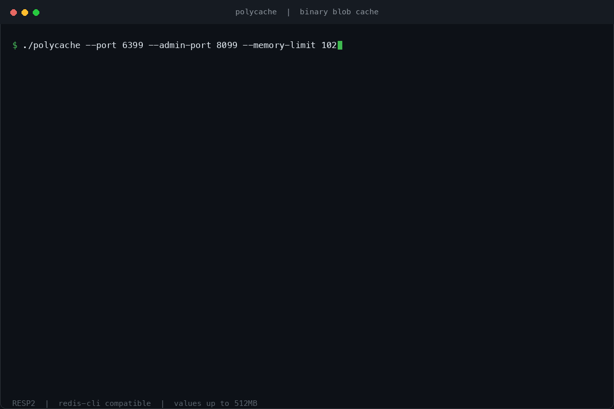
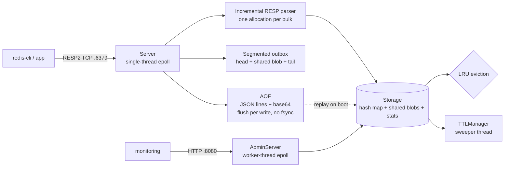

# PolyCache

**A C++17 in-memory cache that speaks Redis RESP2 and stores opaque binary blobs up to 512MB — zero-copy GETs, enforced memory limits, honest persistence.**

[](https://en.wikipedia.org/wiki/C%2B%2B17)
[](LICENSE)



## What it is

PolyCache is a single-node key/value cache. Values are opaque binary strings — a JSON row, a 100KB PNG, and a 512MB object all take the same path through the parser, storage, and GET response. The parser streams each bulk once into its final string; GET streams the stored `shared_ptr<const string>` without copying the payload.

## Highlights

- **Binary-safe blobs to 512MB.** No 64KB frame buffer. A 512MB object round-trips byte-for-byte (SHA-256 verified).
- **Zero-copy GETs.** Values live as `shared_ptr<const string>`; the outbox sends header + blob + trailer without copying the payload.
- **Measured throughput.** 1KB rows: ~310K SET/s, ~245K GET/s. 1MB images: ~3.9K SET/s, ~4.6K GET/s. 512MB resident set: 524.5MB RSS.
- **Operable.** `GET /metrics` and `GET /health` on a separate admin port; graceful shutdown on `SIGINT`/`SIGTERM`.
- **Honest persistence.** AOF is JSON lines with base64 keys/values, flushed per write but **not fsynced**. Use `--no-aof` for large blobs.

## Demo

A GIF of a real session: store a JSON row, store a JPEG with `redis-cli -x`, read both back byte-for-byte (`cmp` identical), then check `/metrics`.

**[TODO: Record demo.gif]** — run `python3 tools/make_demo_gif.py` against a fresh `./polycache --no-aof` server. Requires Pillow and `redis-cli`.

## Architecture

One single-threaded `epoll` loop owns all client I/O (parser → storage → segmented outbox). A second `epoll` loop on a worker thread serves admin HTTP (`/metrics`, `/health`). All cache state is behind one mutex-guarded `Storage`. The only other thread is the ~100ms TTL sweeper.



**Large-value flow:**
1. Parser reads `$<len>`, allocates the argument string once. Payload bytes go straight from `recv()` into the string — no frame buffer, no second copy.
2. `Storage::set` moves the string into a `shared_ptr<const string>` and charges the eviction policy for capacity plus per-entry metadata. Values that don't fit are rejected before the AOF is touched.
3. `GET` copies the `shared_ptr`, not the bytes. Partial sends resume when the fd becomes writable; an eviction can't free bytes a response is still streaming.

## Features

**Protocol**
- RESP2 only: `*<count>\r\n` arrays of `$<len>\r\n<data>\r\n` bulk strings, binary-safe and pipelined.
- Verbs: `SET`, `GET`, `DEL`, `METRICS`, `PING`, `SELECT` (ignored, single database). Unknown verbs get an explicit error.
- Argument count ≤ 1024; declared bulk length capped at `--max-value-size` + 1MB overshoot.

**Storage**
- Default 1024MB memory limit, 512MB max value, 1MB max key.
- Charged at `value.capacity() + 128B` overhead plus key; bucket array included in `used_memory`.

**Eviction**
- LRU behind one interface. All policy calls under the storage lock.

**TTL**
- `SET … EX seconds` and `PX milliseconds`; background sweeper (~100ms) plus lazy expiry. Second granularity; `PX` rounds up.

**AOF**
- One JSON line per `SET`/`DEL`, base64-encoded keys/values. Flushed per write, not fsynced. No rewrite or compaction.

**Admin HTTP**
- `GET /metrics` — memory, hits/misses, evictions, expirations, largest item.
- `GET /health` — `{"status":"ok"}`.

## Benchmarks / Results

Apple M1, 8GB RAM, macOS 26.5, loopback TCP, one client, `--no-aof`, three fresh-server runs, medians. 1KB values are JSON-like 1,024-byte rows; 1MB values are random binary bytes. Keys use ~50% of the 1GB budget (20,000 at 1KB, 512 at 1MB). MB/s are decimal (1e6); memory is MiB.

| Payload | Keys | SET ops/s | GET ops/s | SET p50/p99 | GET p50/p99 | used | RSS | hit rate |
|:--------|------:|----------:|----------:|------------:|------------:|------:|----:|---------:|
| 1KB row | 20,000 | 310,081 | 245,093 | 0.03 / 0.05 ms | 0.03 / 0.06 ms | 22.5MB | 33.2MB | 1.000 |
| 1MB image | 512 | 3,895 | 4,566 | 0.24 / 0.29 ms | 0.29 / 0.46 ms | 512.1MB | 524.5MB | 1.000 |

**512MB smoke test:** SET 0.36s / GET 0.27s, SHA-256 matched. Manual correctness check, not part of the table.

Reproduce:

```bash
make
python3 blob_bench.py --runs 3
```

## Design decisions & trade-offs

1. **Streaming parser over a frame buffer.** A 512MB value is copied once into its final string, never into a 512MB intermediate buffer and then into a value.
2. **Shared values over copies.** `GET` returns `shared_ptr<const string>`, so large reads are zero-copy and eviction stays safe mid-send.
3. **Single-threaded `epoll` over a thread pool.** Cache ops are short map lookups; thread handoff costs more than it saves. Tradeoff: one slow 512MB operation blocks the loop.
4. **RESP2 instead of a custom protocol.** `redis-cli` works without a bespoke client.
5. **Explicit errors over silent option loss.** `NX`/`XX`/`GET`/`KEEPTTL` return `-ERR unsupported SET option` instead of being silently ignored.

## Quick start

```bash
# Build
make

# Run tests
make test

# Start (defaults: port 6379, admin 8080, 1024MB memory, 512MB max value, AOF on)
./polycache

# Disable AOF for large-blob throughput
./polycache --no-aof

# Custom limits
./polycache --memory-limit 2048 --max-value-size 512
```

Talk to it with any Redis client:

```bash
redis-cli -p 6379 SET greeting "hello polycache"
redis-cli -p 6379 SET row:42 '{"id":42,"name":"alice","active":true}'

# Binary blob in, out, verified byte-for-byte
redis-cli -p 6379 -x SET image:demo < photo.jpg
redis-cli -p 6379 --raw GET image:demo | head -c "$(wc -c < photo.jpg)" > out.jpg
cmp -s photo.jpg out.jpg && echo identical

# Observability
curl -s http://127.0.0.1:8080/metrics
curl -s http://127.0.0.1:8080/health
```

Graceful shutdown on `SIGINT`/`SIGTERM`. Requires `g++` with C++17 and `make` (`redis-cli`/`curl` only for examples).

```bash
docker build -t polycache .
docker run --rm -p 6379:6379 -p 8080:8080 polycache
```

## Project structure

```
src/
  server.{h,cpp}      single-thread epoll loop, segmented outbox, RESP dispatch
  storage.{h,cpp}     mutex-guarded map, shared blobs, limits, stats
  protocol.{h,cpp}    incremental RESP2 parser (no frame buffer)
  eviction/           policy.h + lru.cpp (LFU/SIEVE sources retained, unused)
  aof.{h,cpp}         JSON-line AOF with base64 keys/values, flush-only, replay
  ttl.{h,cpp}         background expiry sweeper
  admin.{h,cpp}       HTTP /metrics + /health on worker-thread epoll
  main.cpp            CLI flags, signal handling, boot order
  epoll_compat.h      epoll→poll shim for macOS builds only
tests/
  test_protocol.cpp   parser fragmentation, pipelining, binary payloads, bad headers
  test_storage.cpp    binary round-trip, limits, eviction, empty keys, TTL, overwrite
blob_bench.py         real 1KB/1MB payload benchmark + RSS/used_memory
tools/make_demo_gif.py  generates demo.gif from a real session (Pillow)
demo.gif
Dockerfile / Makefile
```

## Testing

```bash
make test
```

Runs `tests/test_protocol.cpp` (parser fragmentation, pipelining, 1MB binary payload, split trailers, bad headers, empty keys/values) and `tests/test_storage.cpp` (binary round-trip, size limits, LRU eviction, empty-key eviction, TTL expiry, overwrite accounting). Plain C++17 asserts, zero framework.

## Limitations & future work

- **AOF durability:** flush, not fsync; no rewrite/compaction; base64 inflates values ~33%. Best-effort replay log, not a durable database.
- **Single-threaded:** a 512MB SET/GET or slow client can stall others. No worker threads for per-connection outboxes.
- **No auth, TLS, or `maxclients`:** binds all interfaces. Run behind a proxy.
- **RESP2 subset:** no hashes, lists, sets, streams, transactions, pub/sub, `SCAN`, `MGET`/`MSET`. `SELECT` accepted and ignored.
- **SET modifiers:** `NX`/`XX`/`GET`/`KEEPTTL` rejected, not implemented.
- **TTL granularity:** seconds; `PX` rounds up. AOF replay re-applies TTL as a fresh duration.
- **Memory accounting is an estimate:** capacity + 128B/entry + bucket array; RSS can exceed the limit.
- **Single node:** no replication or clustering; cache state is in RAM.

## Tech stack & contact

C++17 · Linux `epoll` (macOS `poll` shim) · `nlohmann/json` (sole vendored dependency) · Docker.

GitHub: https://github.com/ima-d-ice
