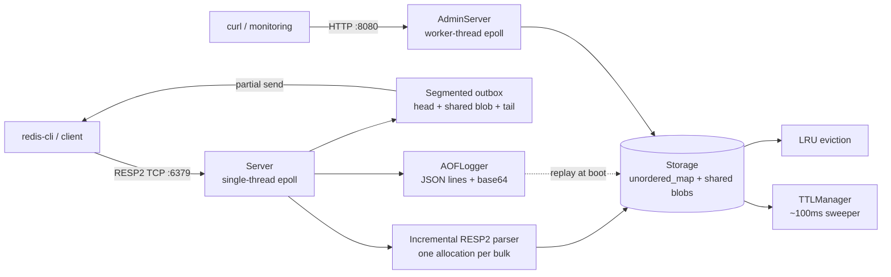

# PolyCache

A C++17 in-memory cache that speaks Redis RESP2 and stores opaque binary values up to 512MiB. I built it to work through the systems details a cache server hides: incremental parsing, bounded memory, non-blocking partial sends, and a persistence log that does not pretend to be a database.

[](https://en.wikipedia.org/wiki/C%2B%2B17)
[](LICENSE)
[](#features)


## Highlights

- **Binary-safe values up to 512MiB.** The parser writes each bulk directly into its final string; a 512MiB random blob round-tripped with matching SHA-256.
- **No user-space copy on GET.** Values are `shared_ptr<const string>`; the outbox sends header, payload, and trailer from the stored allocation. An in-flight GET keeps an evicted blob alive.
- **One client event loop, measured throughput.** 279K SET/s and 227K GET/s for 1KiB rows; 3.1K and 3.5K ops/s for 1MiB blobs on an Apple M1. Single client, loopback TCP. See the benchmark table below.
- **Bounded memory with accounted eviction.** LRU eviction charges string capacity, key bytes, 128B per-entry overhead, and the hash bucket array against the configured limit.
- **Operable.** `/metrics` and `/health` on a separate admin port, graceful shutdown on `SIGINT`/`SIGTERM`, AOF replay, and a Dockerfile.

## Demo


## Architecture

One single-threaded `epoll` loop owns client I/O: read, incremental parse, execute, queue, partial send. A second `epoll` loop on a worker thread serves HTTP admin traffic (`/metrics`, `/health`). Cache state sits behind one mutex-guarded `Storage`; the TTL manager runs a ~100ms sweeper thread. On macOS, a `poll`-based shim stands in for `epoll`.



**SET path:** `recv` → parser allocates the bulk once → AOF appends a line → `Storage::set` moves the value into a `shared_ptr<const string>` and LRU accounts for it → `+OK`.

**GET path:** `Storage::get` returns the shared blob → the outbox sends header, payload, and trailer without copying the payload → `EPOLLOUT` resumes a partial send.

**Persistence:** every applied `SET`/`DEL` is appended and flushed, but not `fsync`ed. Replay walks the log at boot.

## Features

**Protocol**
- RESP2 only: binary-safe bulk strings, pipelined commands, explicit errors for unknown commands.
- Commands: `SET`, `GET`, `DEL`, `METRICS`, `PING`, `SELECT` (accepted and ignored; one database).
- Guards: ≤1,024 arguments, 1MiB key cap, and a declared bulk cap of `min(--max-value-size, memory limit) + 1MiB` so oversized values get a clean error.

**Storage and memory**
- Opaque values from 0 bytes to `--max-value-size` (512MiB by default).
- LRU eviction; memory accounting includes `value.capacity()`, key bytes, 128B per-entry overhead, and the bucket array.
- Memory limit defaults to 1GiB and is enforced after each write.

**I/O**
- Non-blocking `epoll` on Linux; a `poll`-based shim keeps macOS builds working.
- Per-client incremental parser, partial reads, partial writes, and a segmented outbox.
- Outbox capped at 1,024 queued chunks per client.

**TTL and persistence**
- `SET key value EX seconds` and `PX milliseconds`; lazy expiry plus a background sweeper.
- JSON-lines AOF with base64 keys and values; replay on boot; no rewrite or compaction.

**Operations**
- `GET /metrics`: memory, keys, hits/misses, evictions, expirations, largest item.
- `GET /health`: `{"status":"ok"}`.
- CLI flags for ports, memory, max value, AOF file, and `--no-aof`.
- Graceful shutdown on `SIGINT`/`SIGTERM`.

## Benchmarks / Results

**Setup:** Apple M1, 8GB RAM, macOS 26.5, loopback TCP, one client, `--no-aof`, three fresh server processes per payload, medians. Measured 2026-10-23. 1KiB values are JSON-like rows; 1MiB values are random bytes. The 1KiB case uses 20,000 keys (the script's cap); the 1MiB case uses 512 keys (~50% of the 1GiB budget). Throughput is pipelined; p50/p99 are sequential round trips. No eviction occurs in these runs, so this measures the payload path and memory overhead, not policy quality. MB/s is decimal (10^6 bytes/s); memory is MiB.

| Payload | Keys | SET ops/s (MB/s) | GET ops/s (MB/s) | SET p50/p99 | GET p50/p99 | used / RSS | hit rate |
|:--|--:|--:|--:|--:|--:|--:|--:|
| 1KiB row | 20,000 | 279,277 (286) | 226,598 (232) | 0.03 / 0.06 ms | 0.04 / 0.07 ms | 22.5 / 32.6 MiB | 1.000 |
| 1MiB blob | 512 | 3,133 (3,285) | 3,504 (3,674) | 0.27 / 0.51 ms | 0.33 / 0.68 ms | 512.1 / 526.6 MiB | 1.000 |

**512MiB correctness smoke test:** a 512MiB random blob stored and read back through `redis-cli`; SHA-256 matched. End-to-end, including the client: 2.16s SET / 1.97s GET. This is a correctness check, not a throughput benchmark.

Reproduce:

```bash
make
python3 blob_bench.py --runs 3
```

The script starts a fresh server per run, drives it over TCP, and reads `used_memory` from `/metrics` plus RSS from `ps`. Numbers vary with machine load and thermal state.

## Design decisions and trade-offs

1. **Single-threaded `epoll` instead of a thread pool.** Cache operations are short hash-map lookups; a thread handoff costs more than it saves for small values. The trade-off is real: one 512MiB `SET`/`GET` blocks every other client on that loop.
2. **Parse directly into the final string instead of a frame buffer.** A 512MiB value is allocated once from the declared bulk length and filled from `recv`. This avoids a second full-size copy, at the cost of a more stateful parser and holding the allocation until the command completes.
3. **Shared blobs instead of copying values into responses.** `GET` returns a `shared_ptr<const string>`; the outbox sends from that allocation. Eviction cannot free bytes that a response is still streaming. The cost is a control block per value and keeping an evicted blob alive until the last send finishes.
4. **RESP2 subset with explicit errors.** `redis-cli` works without a bespoke client, and the wire format is well specified. The cost is implementing a subset and rejecting what I do not support rather than silently ignoring options.
5. **AOF with flush, not `fsync`.** The log is simple, binary-safe via base64, and inspectable with `jq` after decoding. It is not a durable database: a crash can lose the last writes, base64 inflates values by ~33%, and there is no compaction.

## Quick start

Requires `g++` (or `clang++`) with C++17 and `make`. `redis-cli` and `curl` are only for the examples.

```bash
git clone https://github.com/ima-d-ice/polycache.git
cd polycache
make
make test
./polycache
```

Defaults: RESP2 on `:6379`, admin HTTP on `:8080`, 1GiB memory limit, 512MiB max value, AOF on (`polycache.aof`).

In another terminal:

```bash
redis-cli -p 6379 PING
redis-cli -p 6379 SET greeting "hello polycache"
redis-cli -p 6379 GET greeting

redis-cli -p 6379 SET row:42 '{"id":42,"name":"alice","active":true}'
redis-cli -p 6379 GET row:42

# Binary round-trip
redis-cli -p 6379 -x SET image:demo < photo.jpg
SIZE=$(wc -c < photo.jpg | tr -d ' ')
redis-cli -p 6379 --raw GET image:demo | head -c "$SIZE" > out.jpg
cmp -s photo.jpg out.jpg && echo identical

# Admin HTTP
curl -s http://127.0.0.1:8080/health
curl -s http://127.0.0.1:8080/metrics
```

Run without AOF for throughput or large blobs:

```bash
./polycache --no-aof
```

Custom limits:

```bash
./polycache --memory-limit 2048 --max-value-size 512 --port 6380 --admin-port 8081
```

Docker (optional; the AOF is inside the container and is lost with `--rm`):

```bash
docker build -t polycache .
docker run --rm -p 6379:6379 -p 8080:8080 polycache
```

Graceful shutdown: `Ctrl-C` or `SIGTERM`.

## Project structure

```
src/
  main.cpp            CLI flags, boot order, SIGINT/SIGTERM handling
  server.{h,cpp}      single-thread epoll loop, RESP dispatch, segmented outbox
  protocol.{h,cpp}    incremental RESP2 parser; one allocation per bulk
  storage.{h,cpp}     mutex-guarded map, shared blobs, limits, metrics
  eviction/           policy interface + LRU (LFU/SIEVE sources present, not wired)
  ttl.{h,cpp}         background expiry sweeper
  aof.{h,cpp}         JSON-line/base64 append and replay
  admin.{h,cpp}       HTTP /metrics + /health on a worker thread
  epoll_compat.h      epoll -> poll shim for macOS
  third_party/        vendored nlohmann/json
tests/
  test_protocol.cpp   parser fragmentation, pipelining, binary payloads, errors
  test_storage.cpp    round-trip, limits, LRU eviction, TTL, overwrite accounting
blob_bench.py         fresh-server throughput/latency/memory benchmark
tools/make_demo_gif.py  regenerates demo.gif from a real session
Makefile / Dockerfile / demo.gif
```

## Testing

```bash
make test
```

Expected:

```
ok test_protocol
ok test_storage
```

The tests are plain C++17 asserts with no framework. `test_protocol` covers single and pipelined commands, byte-by-byte fragmentation, a 1MiB binary payload containing `\r\n`, `\0`, and `0xff`, split trailers, oversized bulks, bad headers, empty arrays, unknown verbs, and empty keys/values. `test_storage` covers binary round-trip with `memcmp`, size limits, LRU eviction, the empty-key eviction regression, TTL expiry, and overwrite accounting.

Not covered by automated tests: the server event loop, AOF replay, admin HTTP, and multi-client behavior. I verified AOF replay and a 512MiB binary round-trip manually.

## Limitations and future work

- **AOF is a replay log, not a database.** Flush is not `fsync`; there is no rewrite/compaction; base64 adds ~33%; replay re-applies TTLs as full durations.
- **Single-threaded by design.** A 512MiB operation blocks the loop; a slow reader can accumulate queued responses until the 1,024-chunk cap. There is no `maxclients` and no worker pool for large sends.
- **No auth or TLS.** The cache and admin ports bind all interfaces. Run on a trusted network or behind a proxy.
- **RESP2 subset.** No `MGET`/`MSET`/`SCAN`, hashes, lists, sets, streams, transactions, or pub/sub. `SELECT` is accepted and ignored. `SET` modifiers `NX`/`XX`/`GET`/`KEEPTTL` are rejected.
- **Only LRU is reachable.** LFU and SIEVE implementations are in `src/eviction/` but no runtime switch exposes them.
- **Memory accounting is an estimate.** The limit charges capacity, keys, metadata, and buckets, but RSS can exceed it due to allocator behavior.
- **Single node.** No replication, clustering, or failover. This is a systems project, not a production Redis replacement.

Next: `fsync`/group-commit policy, AOF compaction, server-loop and AOF integration tests, a multi-client saturation benchmark, and a real policy-selection interface.

## Tech stack

C++17 · POSIX sockets · `epoll` (Linux) with a `poll` shim (macOS) · `std::thread`/`std::mutex` · `nlohmann/json` (vendored) · Python 3 (benchmark and demo tooling) · Docker · GNU Make.

## Contact

GitHub: [@ima-d-ice](https://github.com/ima-d-ice) · Repo: [ima-d-ice/polycache](https://github.com/ima-d-ice/polycache)

License: [MIT](LICENSE). Open to backend and systems engineering roles.
